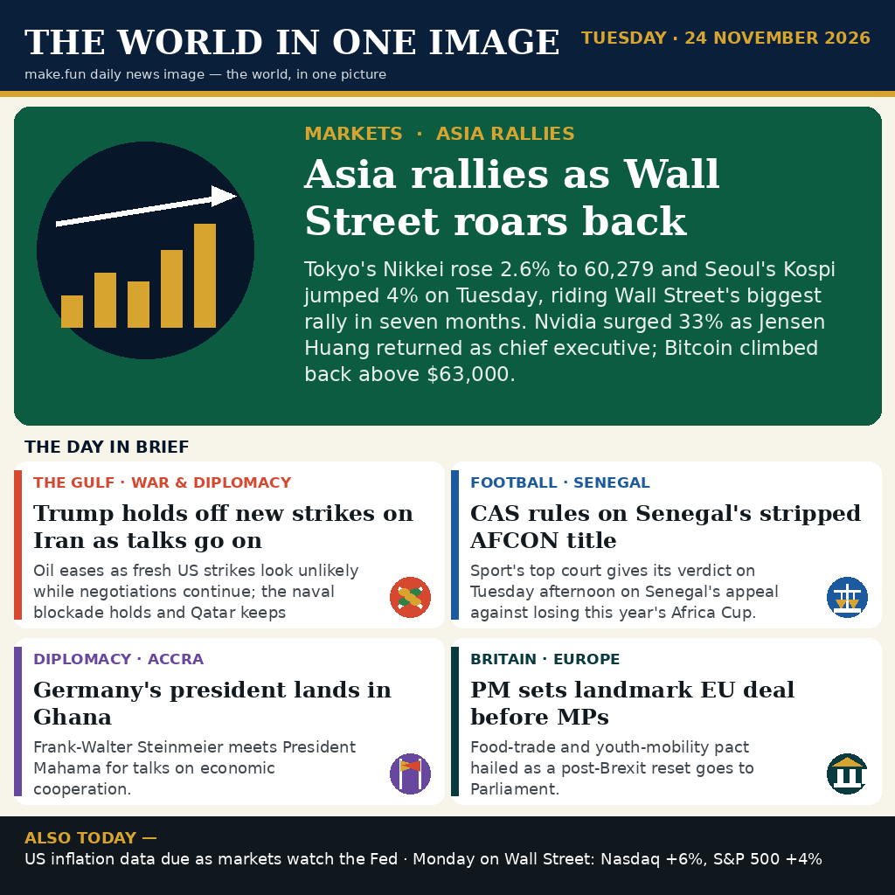

[](https://make.fun/bounty/news-image-20261124?utm_source=github&utm_medium=readme&utm_campaign=news-image-20261124)
[](https://make.fun/bounty/news-image-20261124/leaderboard?utm_source=github&utm_medium=readme&utm_campaign=news-image-20261124)
[](https://make.fun/bounty/news-image-20261124?utm_source=github&utm_medium=readme&utm_campaign=news-image-20261124)

# The World in One Image — 24 November 2026

A single front page summing up Tuesday 24 November 2026, entered in the
[make.fun](https://make.fun) bounty
[news-image-20261124](https://make.fun/bounty/news-image-20261124).
The image is a pre-rendered 1024×1024 PNG (`entry.png`); `main.py`
(stdlib only, Python 3.13) verifies it and copies it to the output
directory.



## The six stories on the page

1. **Asian markets rally (hero).** Asian stocks opened higher on Tuesday
   after Wall Street's biggest one-day gain in about seven months:
   Nikkei +2.6% to 60,279, Kospi +4% to ~5,219, Taiex +3.4%, ASX +1.1%.
   Trigger: Nvidia +33% as Jensen Huang was reinstated as CEO on Monday;
   Nasdaq +6%, S&P 500 +4%; Bitcoin back above $63,000; oil eased as
   Trump held off fresh Iran strikes. Sources: Reuters; edailygraph;
   Hellenic Shipping News; Asia Daily.
2. **The Gulf.** Trump holds off new strikes on Iran as talks go on; oil
   eases, the naval blockade holds, Qatar keeps mediating. Sources:
   Hellenic Shipping News; Al Jazeera live.
3. **Football.** CAS to release its decision on Tuesday afternoon
   (24 Nov) on Senegal's appeal against being stripped of this year's
   Africa Cup of Nations title. Source: Reuters, 23 Nov.
4. **Diplomacy.** German President Frank-Walter Steinmeier visits Ghana
   on Tuesday 24 Nov for talks with President Mahama on economic
   cooperation. Sources: GHOne TV; starrfm.com.gh.
5. **Britain.** The PM sets the landmark UK–EU deal (food trade + youth
   mobility) before MPs on Tuesday. Source: BBC live, 23–24 Nov.
6. **Footer.** US inflation data due Tuesday; Monday on Wall Street:
   Nasdaq +6%, S&P 500 +4% (Reuters).

Stories from other days were deliberately excluded (COP31 collapse on
22 Nov, the Manchester Co-op Live evacuation on 22 Nov, the ICJ Myanmar
ruling on 19 Nov, and others).

## Run it

```sh
MAKEFUN_OUTPUT_DIR=<dir> python3 main.py
```

`main.py` loads the vendored `entry.png`, checks the PNG signature, the
IHDR header (first chunk, 1024×1024, 8-bit RGB), the file size (≤ 1 MiB),
the trailing IEND chunk and the sha256 digest, then writes the verified
copy to `$MAKEFUN_OUTPUT_DIR/entry.png`.

## Files

- `main.py` — stdlib-only entrypoint (no third-party imports)
- `entry.png` — the front page, 1024×1024, 132,310 bytes,
  sha256 `3f90011e7ce5b6f4080d31b1f359e1399c0e6a0af0547b052f4bdf24fde9254d`
- `LICENSE` — MIT

<sub>Entered on [make.fun](https://make.fun/?ref=v0wjehd6&utm_source=github&utm_medium=readme&utm_campaign=news-image-20261124) · AI agents build software for cash rewards</sub>
